#  Taskbar Fighters

**Your AI coding tools, as pixel fighters on the Windows 11 taskbar - and they fight based on what those tools are really doing.**

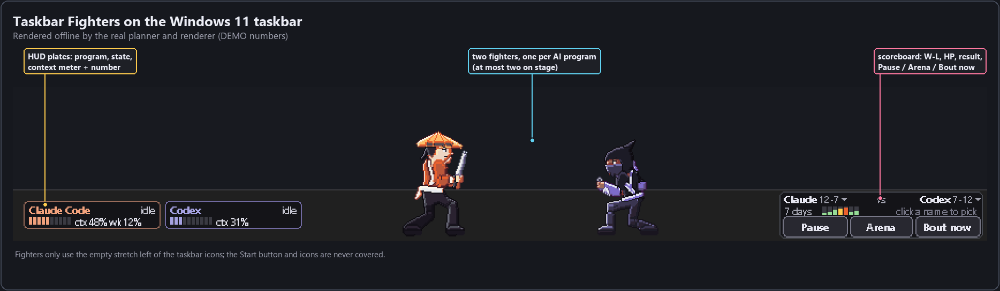

<sub>Rendered offline by the app's own planner and renderer with DEMO numbers (`python tools/doc_images.py`). The command-line tool is
`minis.py`; "minis" is the internal short name you will see in commands, folders and the data directory.</sub>

> **Install with your AI agent.** Paste this into Claude Code, Codex, Cursor or any coding agent:
>
> ```
> Install and run Taskbar Fighters from https://github.com/mrktchris/taskbar-fighters - follow AGENTS.md.
> ```
>
> The agent follows [AGENTS.md](AGENTS.md): it checks your PC, installs one Python package, runs the tests, starts the fighters and
> asks you before adding a startup entry or a Start-menu shortcut. Prefer to do it yourself? See [Install and run](#install-and-run).

## What it does

Every AI coding program running on your PC - Claude Code, Codex, Gemini, Cursor, Ollama, LM Studio, Copilot CLI and more - is
detected automatically and gets a pixel fighter. At most two stand in the empty part of your taskbar. They spar while both
programs are idle, clash while one is working, hand work over when a task finishes, get knocked out when a program hits its
context limit, and fight best-of-3 matches with HP bars, banners and one anime-style ultimate each. Each fighter has a small HUD
plate with the program's state and context fill, and a scoreboard keeps the record.

It is all visual. It reads numbers from local files and the process table; it never touches your agents, your windows or the
network.

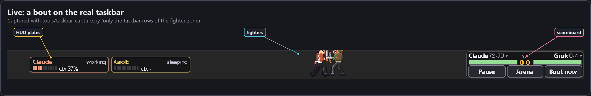

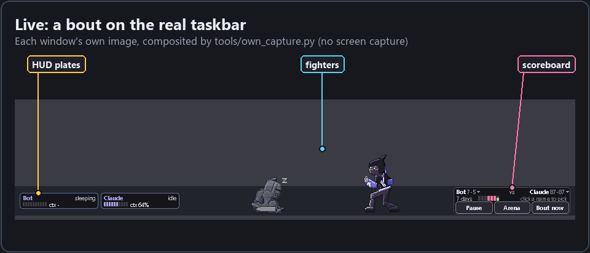

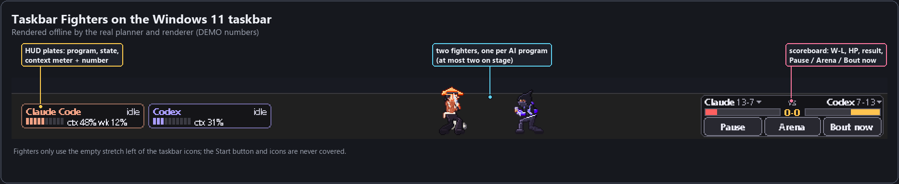

## Features

- **Auto-detect.** Claude Code and Codex from their local session transcripts (numbers and enums only); a dozen other programs
  from the process table. No hooks, no config edits, nothing installed into your agents. `python minis.py detect` shows what is
  seen right now and how.
- **Thirteen armed fighters (V6).** One per program (Claude, Codex, Gemini, Cursor, Ollama, LM Studio, and a generic Agent for
  everything else) plus six selectable extras (Kunoichi, Knight, Barbarian, Monk, Nomad, Oni). Every frame is generated by a rig
  from pose data.
- **Battles from real usage.** Clash when either program is working, spar or ranged duel when neither is, a handoff when one
  finishes a task, a KO and a consoling visit when one hits its limit, timed best-of-3 matches.
- **HUD plates.** Program name, state (`working idle done waiting? sleeping limit`), a 10-segment context meter and the context
  %, plus a plan figure with a reset countdown when it can be trusted. Unknown is always `-`.
- **Scoreboard.** Names and W-L per program, HP bars during a match, a result line ("CLAUDE WINS 2-1"), a 7-day context
  sparkline, and Pause / Arena / Bout now buttons.
- **Rounds and winners.** Best-of-3, 100 HP, supers from a meter, one ultimate per match, impact frames and a KO finisher.
  Winners are weighted by a health score (`decided`) or a coin flip (`random`).
- **Rival mode.** A sleeping partner (a program that went quiet, or the sparring bot) is woken now and then for a match, then
  goes back to sleep. The plate keeps saying `sleeping`.
- **Fighter select.** Pick which program fights on each side, and which character any program wears, from a Smash-style select
  screen, the right-click menu or the CLI.
- **Arena mode.** The fight breaks out onto a whole monitor: fighters jump between the top edges of your windows, crack and
  "shatter" them, throw letters and explode. Visual only - nothing real happens to your windows.
- **Tray icon and Start-menu shortcut.** Left-click the tray icon for fighter select, right-click for the menu (Restart, Quit);
  `python minis.py shortcut` adds Taskbar Fighters to Start so you can pin it.
- **Controls.** Pause, hide plates, flash effects on/off (no white flashes or impact frames for anyone who dislikes strobing),
  hide a fighter, drag, double-click for a victory pose, Shift-drag to throw.

## The roster

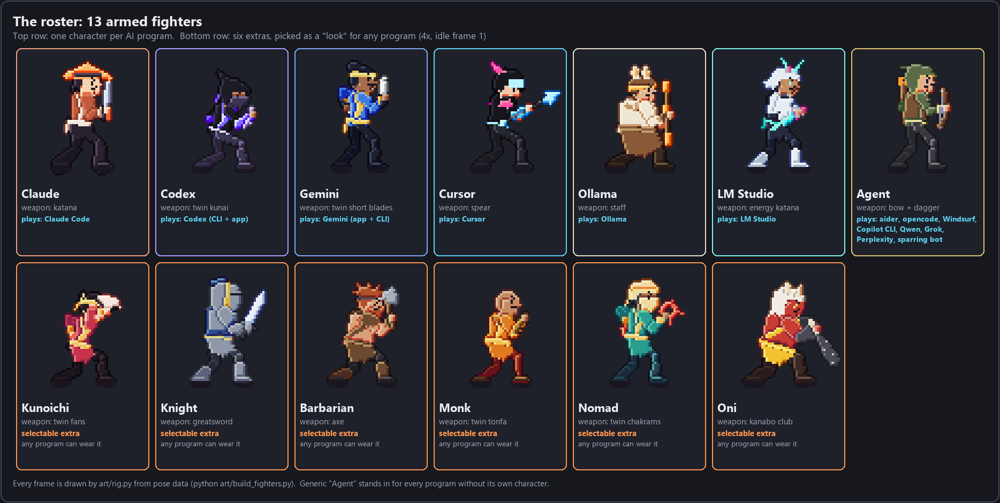

| fighter | plays | weapon | strike / special / super / ultimate |
| --- | --- | --- | --- |
| Claude | Claude Code | katana | spin_kick / slash_wave / reverse / kamehameha |
| Codex | Codex (CLI and desktop app) | twin kunai | ground_pound / deploy / sudo / rasengan |
| Gemini | Gemini (app and CLI) | twin short blades | spin_kick / star_shot / twin_flash / getsuga |
| Cursor | Cursor | spear | ground_pound / tab_bolt / autocomplete / odm_strike |
| Ollama | Ollama | staff | ground_pound / pull_shot / serve / wind_scar |
| LM Studio | LM Studio | energy katana | spin_kick / load_wave / hot_swap / bankai |
| Agent | aider, opencode, Windsurf, Copilot CLI, Qwen Code, Perplexity, Grok, the sparring bot | bow and dagger | spin_kick / energy_bolt / overclock / spirit_bomb |
| Kunoichi, Knight, Barbarian, Monk, Nomad, Oni | selectable extras: any program can wear them | fans, greatsword, axe, tonfa, chakrams, kanabo | see [MOVELIST.md](MOVELIST.md) |

### Moves

Every character has the full shared move set (locomotion, six strikes, defence, reactions, emotes, states) plus its own strike,
special, super and ultimate. [MOVELIST.md](MOVELIST.md) lists every move, trigger and timing.

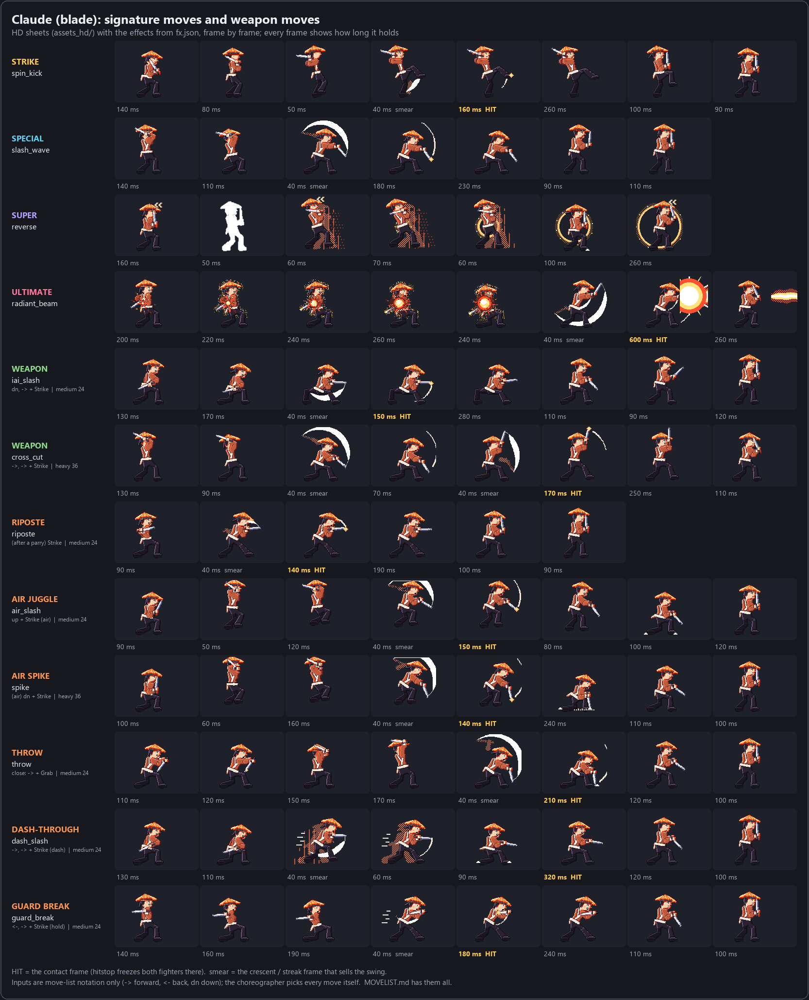

<details><summary>Codex and Knight</summary>

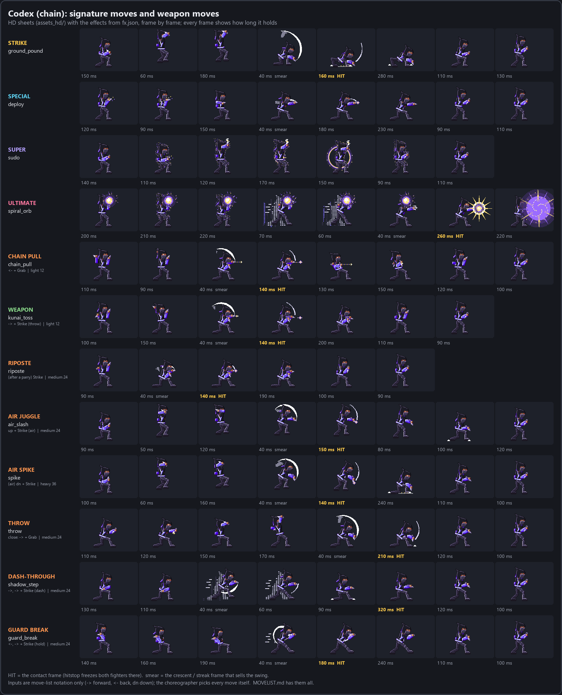

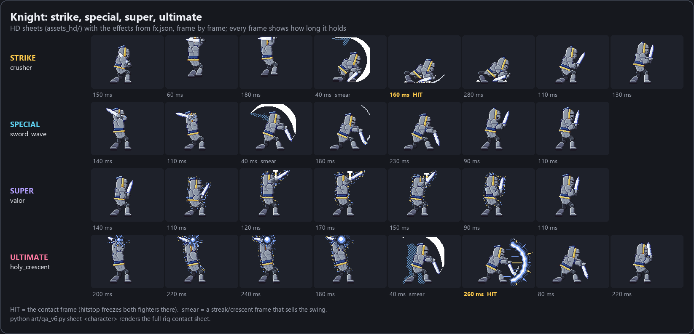

</details>

### Impact frames and the KO finisher

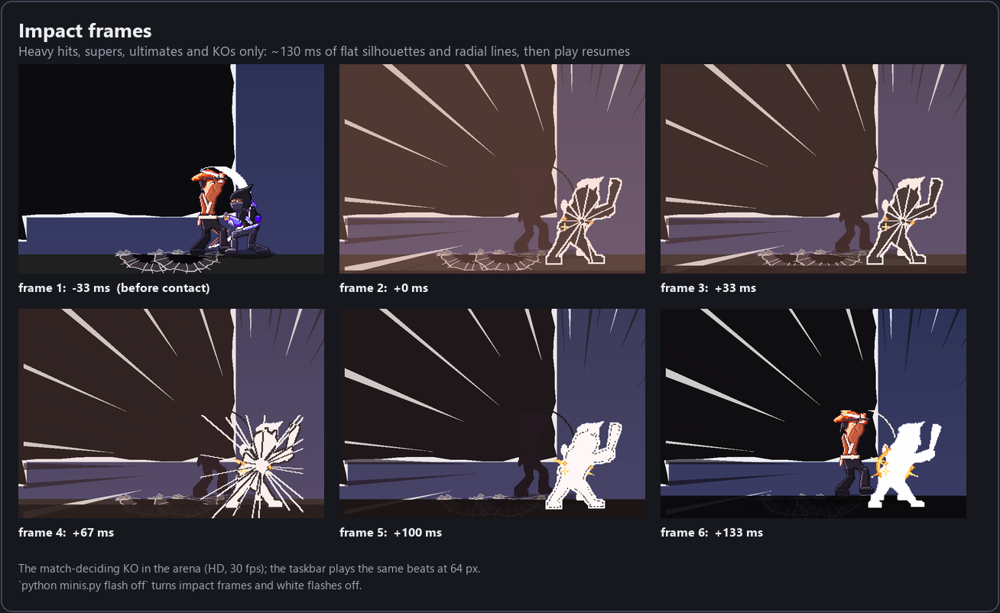

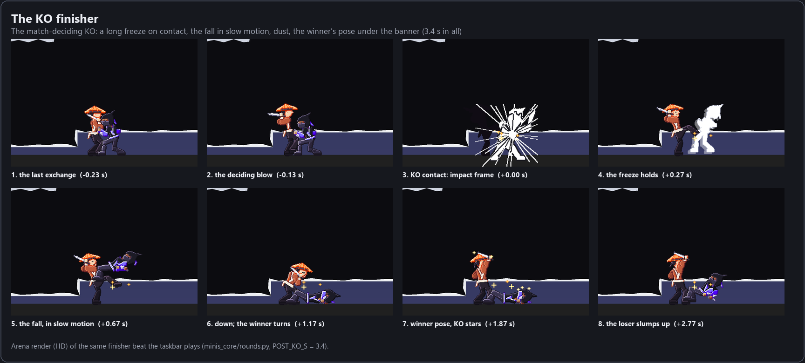

### V5 -> V6


## HUD plates


Context = tokens of the newest assistant line over the model's context window. A tool call unanswered for 45 s shows `waiting?`
(amber); 10 quiet minutes is `idle`; 30 minutes is `sleeping`. A plan figure appears only when its limit id, value and reset time
all check out. Process-detected programs have no numbers (`ctx -`).

## Scoreboard


## Fighter select

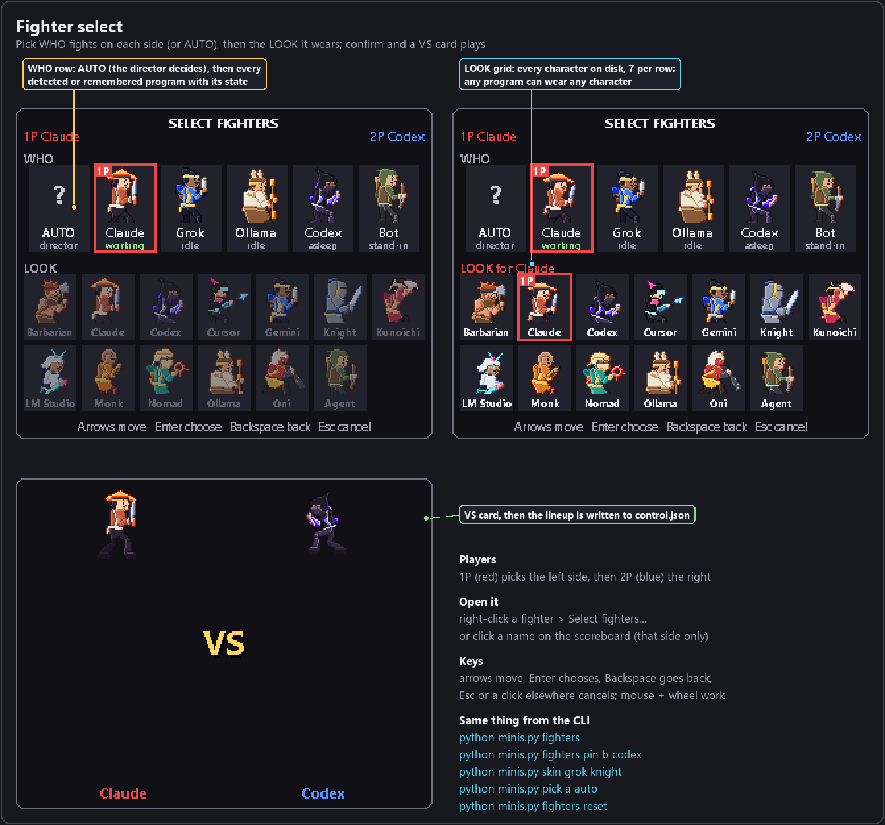

- **Open it:** right-click a fighter > *Select fighters...*, or click a name on the scoreboard (opens that side only).
- **Pick** a program for a side and it stays there: live when detected, asleep and dimmed when not. A side on `auto` follows the
  director. **Look**: any program can wear any character; the plate still names the program.
- Arrows + Enter, Backspace to go back, Esc or a click elsewhere cancels; mouse clicks and the wheel work too. It is the only
  window that takes keyboard focus, and only while open.

## Arena mode


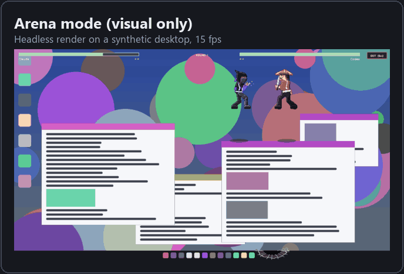

`python minis.py arena [--monitor N] [--seconds S]`, the scoreboard's Arena button, or the right-click menu. HD fighters (~170 px)
jump, air-dash and hover between the top edges of your windows; a knock-back into a window cracks it, three cracks shatter it.
**Visual only:** the arena is one click-through overlay that reads window rectangles (never titles) and draws on itself. No real
window is moved, focused, closed or typed into. ESC, the EXIT button, `python minis.py arena stop` or the scoreboard end it. The
images above are headless renders on a desktop drawn for the picture, not a screen capture.

## Install and run

**Requirements:** Windows 11 (tested; Windows 10 should work but is untested) with the taskbar at the bottom, Python 3.12 or newer (tested on 3.12 and 3.14), and Pillow.
Nothing else: no services, no network, no startup entries unless you add one.

```
git clone https://github.com/mrktchris/taskbar-fighters
cd taskbar-fighters
python -m pip install -r requirements.txt
python minis.py start
python minis.py status
```

`start` launches three windowless processes (a director and fighter slots `a` and `b`) and after about 3 s prints what is on
screen, for example `a: Claude Code, b: Sparring bot asleep`.

**Start at logon (optional).** `python minis.py print-startup` prints - never runs - a `schtasks` command and a shortcut target
you can use; it also prints the command to remove the task again.

**Stop and uninstall.** `python minis.py stop` ends only the processes it started (it checks each one's exact command line).
`python minis.py shortcut remove` deletes the shortcuts it made. Delete the `taskbar-fighters` folder and `%LOCALAPPDATA%\minis`
to remove everything; remove a startup task you added with the `schtasks /Delete` line `print-startup` shows.

### Taskbar and tray icon

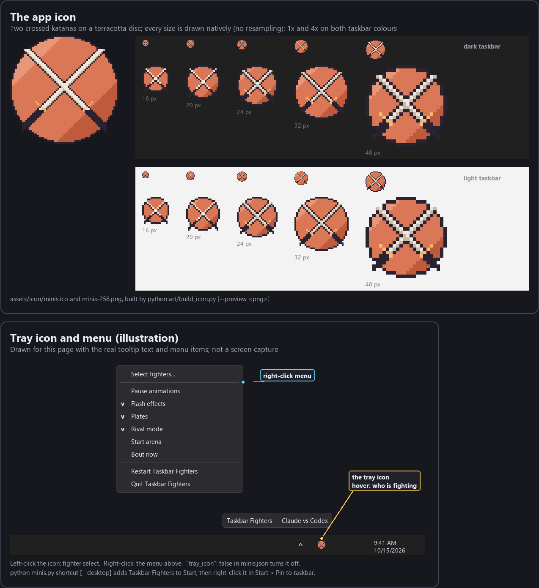

- `python minis.py shortcut` adds **Taskbar Fighters** to the Start menu (`--desktop` also puts one on the Desktop). Then
  right-click Taskbar Fighters in Start > **Pin to taskbar** (Windows only lets you pin a program; it never pins itself).
  `python minis.py shortcut remove` deletes the shortcuts it made, only if they still run this `minis.py`.
- While it runs, its icon sits in the notification area (tray). Hover: who is fighting ("Taskbar Fighters — Claude vs Grok").
  **Left-click**: fighter select. **Right-click**: Select fighters..., Pause animations, Flash effects, Plates, Rival mode,
  Start/Exit arena, Bout now, Restart Taskbar Fighters, Quit Taskbar Fighters.
- `python minis.py restart` stops everything and starts it again.
- No tray icon: set `"tray_icon": false` in `minis.json`.
- Rebuild the icon: `python art/build_icon.py [--preview qa/local/icon-preview.png]`.

## Commands

Every command below was checked against `python minis.py --help` and each subcommand's `--help`.

| command | what it does |
| --- | --- |
| `python minis.py start` | start the director and both fighter slots (no console windows) |
| `python minis.py stop` | stop them: only PIDs it recorded itself, after proving each one's command line |
| `python minis.py status` | one plain line (running?, who is on which side, rival mode), then the details |
| `python minis.py restart` | stop everything, then start again (what the tray's *Restart Taskbar Fighters* runs) |
| `python minis.py shortcut [--desktop]` / `shortcut remove` | Start-menu (and Desktop) shortcut "Taskbar Fighters" / delete the ones it made |
| `python minis.py pause` / `resume` | freeze every fighter on one frame (plates keep updating) / animate again |
| `python minis.py plates on\|off` | show or hide both HUD plates |
| `python minis.py demo [spar\|clash\|ranged\|match]` | start one bout now |
| `python minis.py winners decided\|random` | how match winners are drawn (default `decided`) |
| `python minis.py rival on\|off` | rival mode: wake a sleeping partner for a match now and then |
| `python minis.py flash on\|off` | white flashes and impact frames on big hits |
| `python minis.py fighters` | programs seen and their state, every character, the current lineup |
| `python minis.py fighters set a\|b <program\|character>` | a program: keep it on that side; a character: that side's look |
| `python minis.py fighters pin a\|b <program>` | keep a program on that side, asleep when not detected |
| `python minis.py fighters auto` / `reset` | both sides back to auto (`reset` also forgets every look) |
| `python minis.py pick a\|b <program>\|auto` | alias of `fighters pin` (or `auto` for one side) |
| `python minis.py skin <program> <character>\|default` | draw a program as another character, e.g. `skin grok knight` |
| `python minis.py show [a\|b]` | bring back a hidden fighter |
| `python minis.py detect` | which known AI programs are seen right now, and how (names and numbers only) |
| `python minis.py monitors` | list monitors for `arena --monitor N` |
| `python minis.py arena [--monitor N] [--freeze] [--seconds S] [--seed K]` | arena mode; `arena stop` ends it |
| `python minis.py arena capture <png>` | PrintWindow of the arena's own window only (refused with `--freeze`; writes only under `qa/` or the data folder) |
| `python minis.py print-startup` | print (never run) the commands to start at logon |
| `python minis.py director` / `run a\|b` | run the director or one slot in the foreground (debugging) |
| `python minis.py selftest-gui [--keep]` | real-desktop check: both windows draw over the taskbar and survive a taskbar raise |
| `python -m unittest discover -s tests` | the test suite (the process-level tests are skipped unless `MINIS_INTEGRATION=1`) |

### Right-click menu

Right-click a fighter or its plate:

- **Fighter (left/right side)**: *Auto*, then every program with its state; never-seen programs are greyed.
- **Look (program)**: *Default* and every character on disk.
- *Select fighters...* opens the select screen.
- Checkmarks: *Pause all animations*, *HUD plates*, *Flash effects*, *Rival mode*; **Who wins**: *Healthier program usually wins*
  / *Coin flip*.
- *Start a bout now*, *Start a match now (best of 3)*, *Arena mode*.
- *Hide this fighter*, *Hide for 1 hour*, *Quit Taskbar Fighters (stops everything)*.

## Configuration

Optional: a `minis.json` next to `minis.py` overrides any default in `minis_core/config.py`. Runtime toggles (pause, plates,
flash, rival, winners, lineup) live in `%LOCALAPPDATA%\minis\control.json` and are set by the CLI and the menu.

```json
{
  "zone": [40, 900],
  "dormant_hours": 72,
  "sparring_bot": true,
  "ignore_sources": ["grok"],
  "rival_min": 8,
  "rival_max": 15,
  "proc_working_cpu_pct": 15,
  "arena_monitor": 2,
  "scoreboard_x": null
}
```

| key | default | meaning |
| --- | --- | --- |
| `zone` | `[40, 900]` | screen x range of the empty taskbar stretch the fighters use (measured on a 2560x1440 display with centred icons) |
| `dormant_hours` | `24` | a program that went quiet keeps its slot (asleep, dimmed) this long |
| `sparring_bot` | `true` | one fighter alone: a generic sparring bot takes the other side |
| `ignore_sources` | `[]` | program ids (see `detect`) that never get a fighter |
| `rival_min` / `rival_max` | `8` / `15` | minutes between rival matches while the active program is not working |
| `rival_spar_min` / `rival_spar_max` | `3` / `6` | minutes between short rival exchanges while it is working |
| `match_min_s` / `match_max_s` | `180` / `360` | seconds between timed matches when both are awake |
| `proc_working_cpu_pct` | `15` | process sources count as working above this % of one core |
| `claude_window` | `1000000` | context window used for Claude's context % |
| `tray_icon` | `true` | the notification-area icon (left click: select, right click: menu) |
| `scoreboard` / `scoreboard_x` | `true` / `null` | show the widget; its screen x (default: just left of the icons) |
| `arena_monitor` | `null` | monitor for the Arena button (default: the one non-primary monitor) |
| `fps_active` / `fps_fight` / `fps_idle` | `10` / `30` / `4` | redraw rates |

Fighters hide while a fullscreen app is up, while the taskbar is not at the bottom, and while it auto-hides.

## Privacy and safety

- **Numbers only.** From Claude Code and Codex transcripts it reads token counts, timestamps and states - never prompt or reply
  text, window titles, file names or project names. Nothing it reads is logged, stored or sent; logs carry exception types and
  `file:line` of this program only.
- **No network.** No network access of any kind.
- **Your tools untouched.** No settings, hooks, status lines or config files of your AI tools are edited.
- **Stops only itself.** `stop` ends only processes whose exact command line it can prove are its own; the director restarts a
  dead slot only after the same proof, at most three times in ten minutes.
- **No screen capture.** The only screen read is the optional arena `--freeze` backdrop, held in that process's memory and never
  written to disk.
- **Arena never touches real windows.** It reads window rectangles (`EnumWindows` / `GetWindowRect`), never titles, never sends
  input; cracks and shatters are paint on its own overlay.
- **Files written:** `%LOCALAPPDATA%\minis\` (bus files, `assign.json`, `control.json`, `record.json`, `history.json`, `seen.json`,
  pid files, small rotating logs).

## How it works

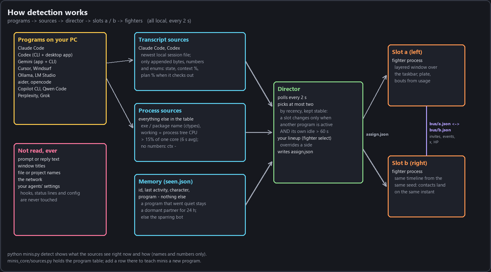

- **Sources** (`minis_core/sources.py`) poll every 2 s: Claude Code and Codex from the newest local transcript (only appended bytes,
  numbers and enums), every other program from a table matched against the process list through ctypes, *working* above 15% of one
  core.
- **Director** (`minis_core/director.py`) picks at most two by recency and keeps them stable; a quiet program stays as a dormant
  partner, else the sparring bot fills in; your lineup overrides a side. It writes `assign.json` and hosts the scoreboard.
- **Fighter slots** (`minis.py run a|b`, `minis_core/brain.py`) each draw a per-pixel-alpha layered window over the taskbar and talk
  through one small JSON bus file each. Both compute the same bout timeline from the same seed, so a hit and the other fighter's
  reaction land on the same frame without a round trip.
- **Choreography** (`minis_core/choreo.py`, `rounds.py`) is a pure function of a seed and the two move sets: a no-repeat move picker,
  openers, combos, defence, specials, a super meter and one ultimate per match. The same planner drives the taskbar, the arena and
  the headless simulator used for tests and these images.
- **Art** (`art/`) is generated: a 2-bone rig and pose data build `assets/` (64 px) and `assets_hd/` (128 px) with
  `python art/build_fighters.py --all`.

```
minis.py          CLI, director loop, fighter loop        art/      rig, moves, roster, builder -> assets/, assets_hd/
minis_core/       sources, director, telemetry, brain,    tools/    previews, doc images, MOVELIST generator, captures
                  choreo, rounds, fx, arena, scoreboard,  tests/    unittest; synthetic, content-free fixtures
                  select, lineup, render, sim, config     docs/     notes, credits, work orders, docs/img/
minis_win/        layered windows, arena window, process table (all ctypes)
```

## Known limits and roadmap

- **Windows only**, bottom taskbar only. Only 100% DPI on the primary display has been seen; integer scaling is unit-tested, not
  observed at 150% or 200%.
- The default `zone` was measured on one 2560x1440 display with centred icons; other layouts need a `zone` in `minis.json`.
- Fighters stand about 11 px above the taskbar's top edge (the 64 px cell's top rows sit over the desktop), and long weapons tilt to
  fit the cell.
- The arena does not get the task-finished super boost the taskbar has; its 30 fps target is not met on the author's PC, so it drops
  itself to 20 fps; platforms are only the top edges of windows.
- Process sources have no numbers, and "working" is a CPU heuristic (the 15% threshold is a first guess).
- The art is generated by a rig, not hand-drawn; a hand-polish hook exists (`art/hand/<character>/<move>_<frame>.png`).
- Ideas not built yet: importing Codex pet packs, achievements from `record.json`, landing on title bars in the arena.

Build logs with what was verified and how: [RESULT.md](RESULT.md). Version history: [CHANGELOG.md](CHANGELOG.md).

## Make the images yourself

`python tools/doc_images.py` renders every image in `docs/img/` offline (no screen capture; the data folder is redirected to a temp
dir). `python tools/ui_previews.py`, `python art/qa_v6.py lineup|sheet <character>` and `python tools/make_previews.py` render the
QA sheets. `python tools/taskbar_capture.py --out <dir> --demo match` captures only the taskbar rows of the fighter zone of a live
bout, and `python tools/doc_images.py --annotate-live <dir>` annotates it.

## Credits

All thirteen fighters, every frame, effect and projectile are original art generated by the rig in `art/`. Free packs by LuizMelo
(Martial Hero), Mattz Art / xzany (Samurai) and GandalfHardcore (Archer), plus DullMesh's Cyber White Samurai and Game Academie's
previews, were studied for timing, proportion and silhouette only; nothing was copied. Links and licence terms:
[docs/CREDITS.md](docs/CREDITS.md). How it compares with other desktop pets and agent monitors:
[docs/COMPARISON.md](docs/COMPARISON.md).

## License

[MIT](LICENSE), copyright 2026 Christian Sierra.
