# minis

Pixel-art fighters for your AI coding agents, living on the Windows taskbar.

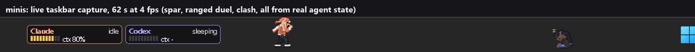

Small pixel fighters stand in the empty part of the Windows 11 taskbar. A director notices which AI programs you
are using (Claude Code, Codex, Cursor, Gemini, Ollama, LM Studio, aider, opencode, Windsurf), gives at most two of
them a fighter, and the two spar, hand work over, console each other and fight best-of-3 matches based on what
those programs are really doing. Each fighter carries a fighting-game HUD plate with real numbers when they exist.

Everything is visual. It reads numbers, it never touches your agents, your windows or the network.

## Features

- **Auto-detection**: Claude Code and Codex from their local session transcripts (numbers and enums only), seven
  other programs from the process table. No hooks, no config edits, nothing installed into your agents.
- **Two slots, a director**: at most two fighters at a time, assigned by recency, kept stable; a program that vanishes
  keeps its slot for a few seconds; a slot with nothing to show hides.
- **Live HUD plate** per fighter: program name, state (`working idle done waiting? sleeping limit`), context fill of
  the active session as a 10-segment bar, and a plan figure with a reset countdown when it can be trusted.
- **Bouts from usage**: clash when either is working, spar or ranged duel when neither is, a handoff when one
  finishes a task, a KO and a consoling visit when one hits its limit, nothing when one is asleep.
- **Matches**: best-of-3 rounds with HP, `ROUND / FIGHT! / K.O. / WINNER` banners, hit, block, dust and KO effects,
  and one anime-homage ultimate per character. Winners are drawn by a health score (`decided`) or evenly (`random`).
- **Scoreboard widget**: W-L per character, mode, a 7-day context sparkline, HP bars during a match, three buttons.
- **Arena mode**: a full-monitor click-through overlay where the HD fighters jump between the top edges of your
  windows, crack and shatter them, throw letters and shake the screen. All of it is drawn on the overlay; no real
  window is moved, focused or closed.
- **Pause**, **hide plates**, **drag**, double-click for a victory pose, a right-click menu, pupils that follow the
  cursor, a dizzy spell after a fast drag, Shift-drag to throw.
- **Seven original characters**, 48 moves each, built by a 2-bone rig from pose data; the V5.1 redesign gives each
  one a silhouette feature, an accent colour and an HD rim light. Every frame is generated and reproducible with one
  command.
- **Choreographed fights** (V5): a seeded no-repeat planner picks openers, combos, defence, spacing, specials, a super
  when the meter fills and one ultimate per match; beams extend from the hands, hits freeze both fighters for a
  hitstop, and an ultimate landing flashes the frame white.

## Screenshots

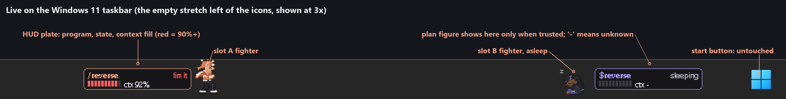

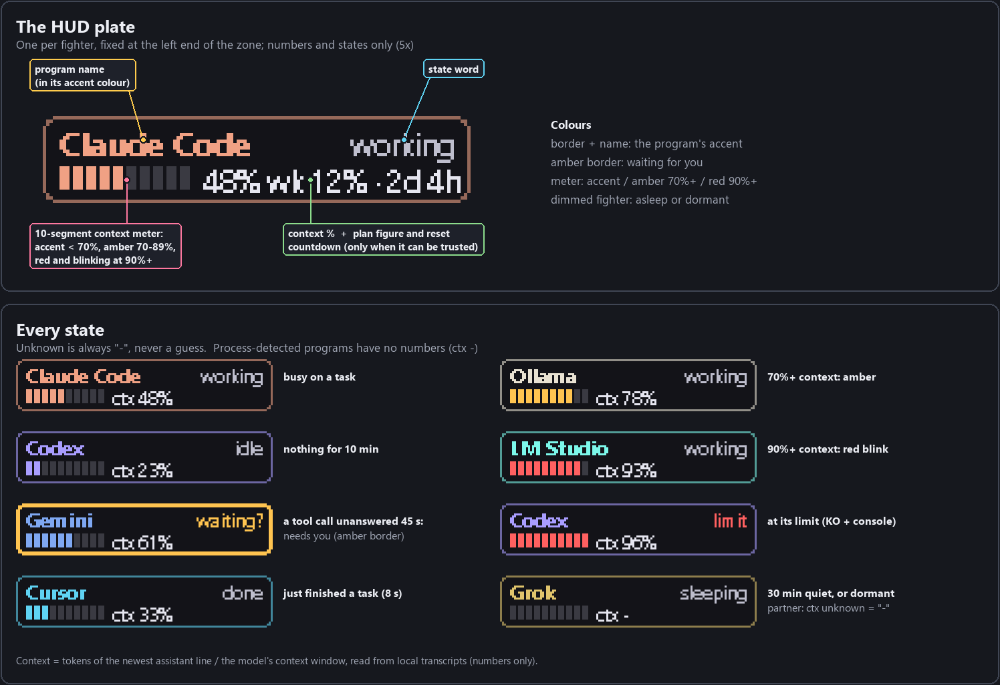

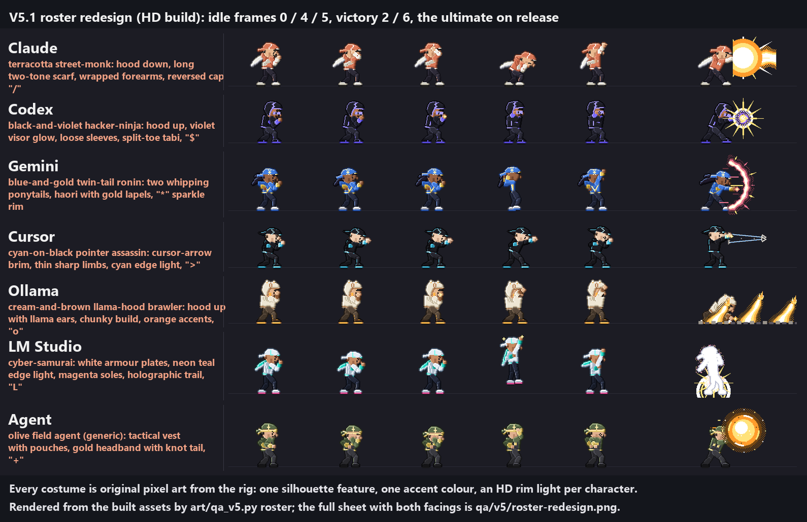

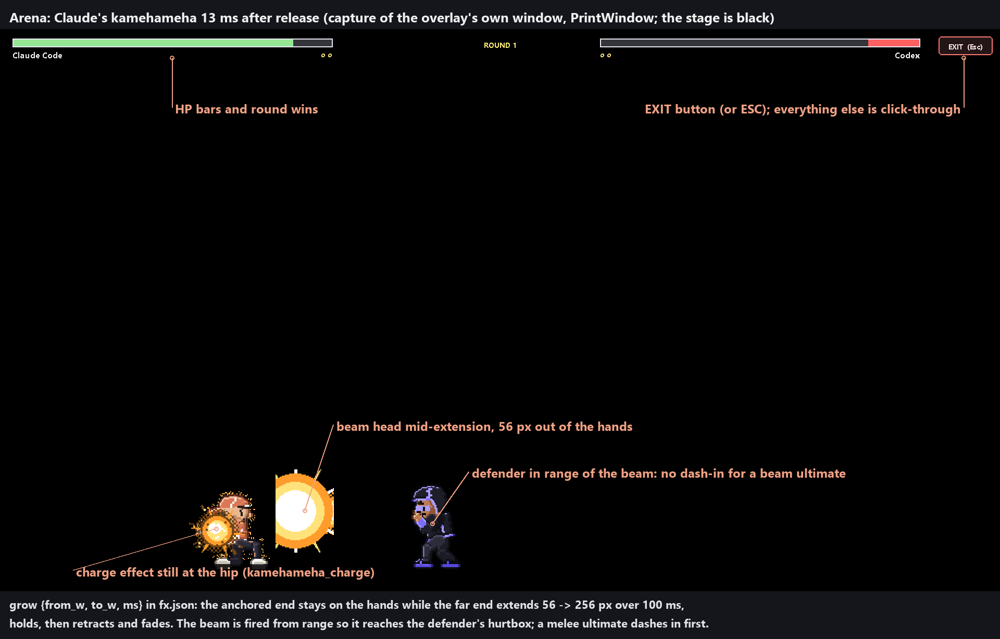

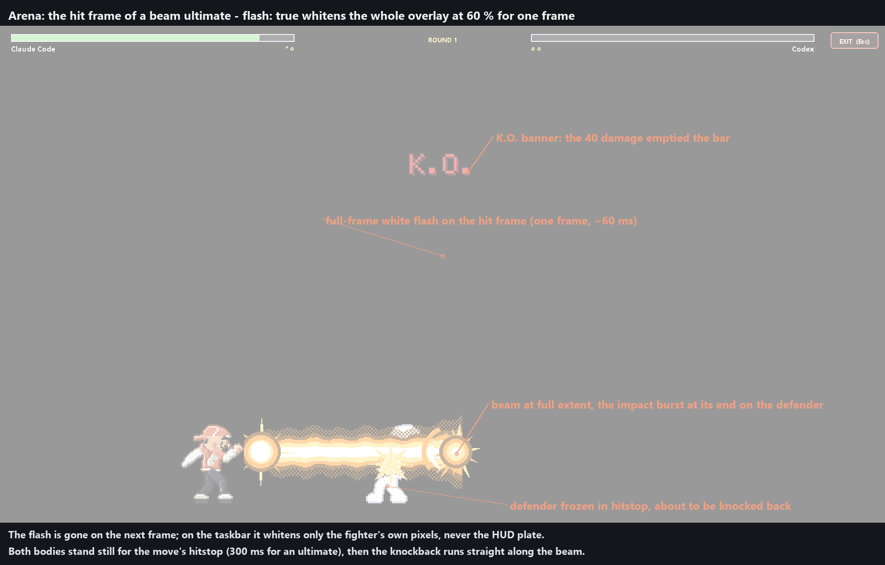

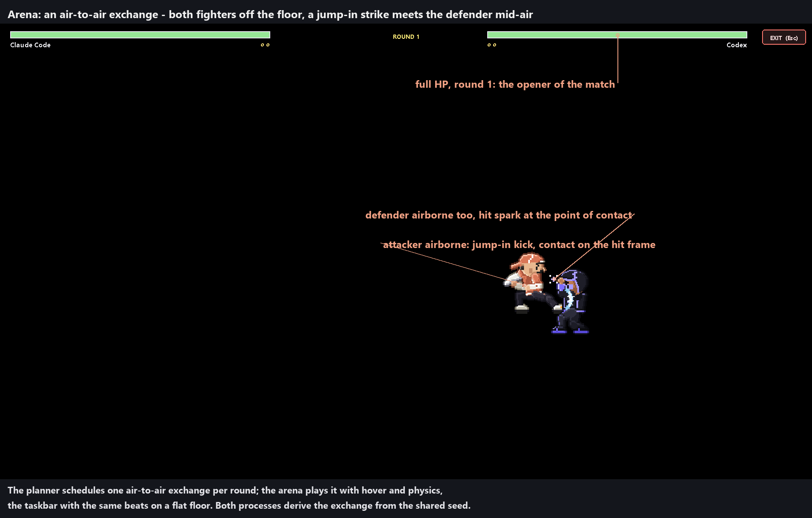

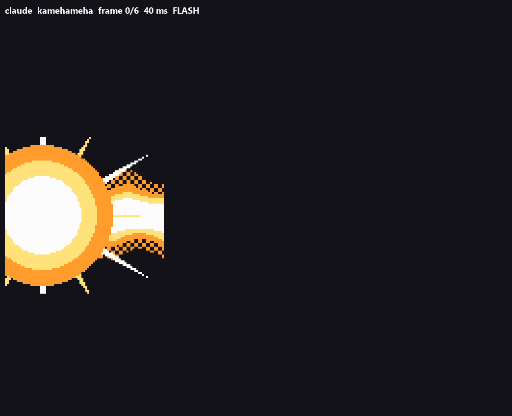

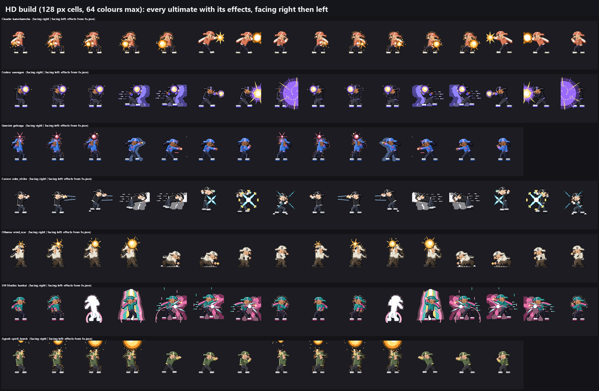

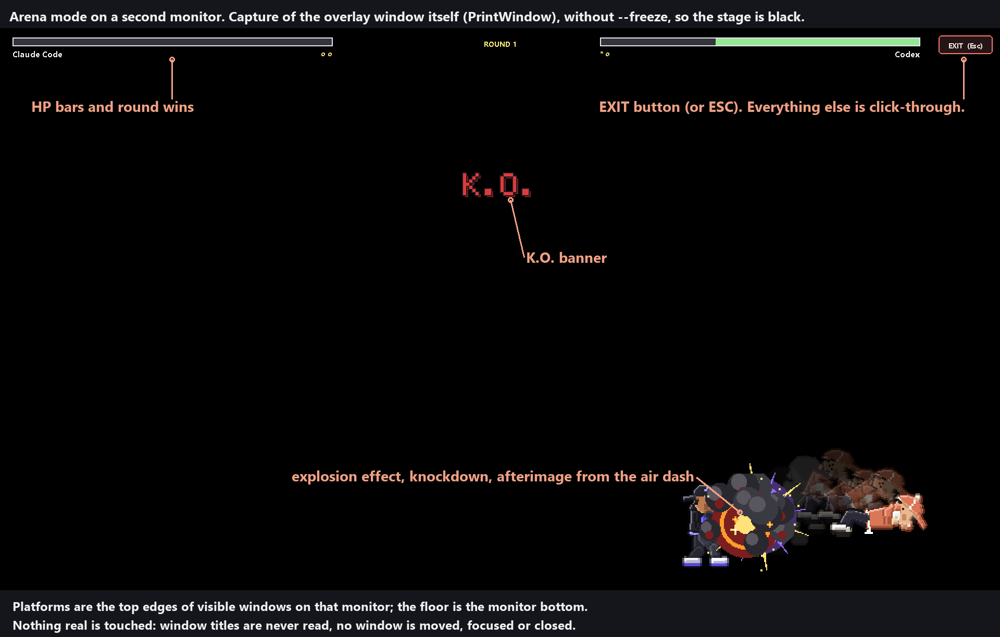

The taskbar, plate, ultimates and arena-K.O. images were captured before the V5.1 costume redesign; the roster sheet
and the three arena captures are current. The arena captures are PrintWindow shots of the overlay's own window (so
the stage is black), taken by `tools/arena_capture.py`; nothing on the desktop is read.

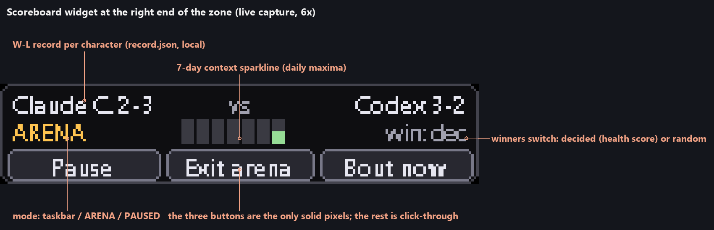

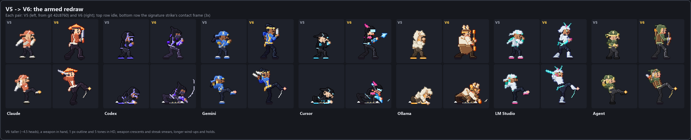

## How it works

**Detection -> director -> slots.** `minis.py start` launches three windowless processes: a director and fighter slots
`a` (left half) and `b` (right half).

- Sources (`minis_core/sources.py`) poll every 2 s. Claude Code and Codex are read from the newest local transcript
  (`~/.claude/projects/*/*.jsonl`, `~/.codex/sessions/.../rollout-*.jsonl`); the other programs are matched from the
  process table through ctypes and are *working* while their process tree uses more than 15% of one core.
- The director (`minis_core/director.py`) picks at most two sources by recency and writes `assign.json` atomically.
  A slot keeps its source until another one is active **and** its own has been idle for more than 60 s.
- Each slot process runs a fighter (`minis.py`, `minis_core/brain.py`), draws a per-pixel-alpha layered window over
  the taskbar, and talks to the other slot through one small JSON file each (`bus/a.json`, `bus/b.json`). Both sides
  compute the same bout timeline from the same invite, so a strike's contact frame and the other fighter's hit
  reaction land on the same instant without a round trip.

**Telemetry trust rules.** Context = tokens of the newest assistant line over the model's context window. A tool
call unanswered for 45 s shows `waiting?`; 10 quiet minutes is `idle`; 30 minutes is `sleeping`. A plan figure is
shown only when its limit id, value and reset time all check out and the reset is still in the future; a window that
expires while the file sits still disappears on time. Unknown is always `-`, never a guess, and a "task % complete"
is not faked because it cannot be measured. Full rules: the *Telemetry* section further down.

**Privacy guarantees.**

- Only numbers and enums leave the parsers. No prompts, titles, file names or project names are read into the
  display, logged, stored or sent anywhere. Logs carry exception types, error numbers and `file:line` of this
  program only.
- No network access of any kind.
- Nothing in your agents' settings, hooks, status lines or config files is touched.
- The arena reads window rectangles (`EnumWindows` / `GetWindowRect`), never titles, and never sends input. The
  optional `--freeze` backdrop is a screenshot held only in that process's memory; it is never written to disk.
- Files written: `%LOCALAPPDATA%\minis\` (bus files, `assign.json`, `control.json`, `record.json`, `history.json`,
  pid files, small rotating logs) and, for previews and the self-test, this folder.
- `stop` only ends processes whose exact command line it can prove are its own.

## Install and run

Requirements: Windows 11 with the taskbar at the bottom, Python 3.14 (what it was built and tested on) and Pillow.
Nothing else; no pip packages beyond Pillow, no services, no startup entries.

```
git clone https://github.com/mrktchris/minis
cd minis
pip install pillow
python minis.py start
```

```
python minis.py start            director + fighter slots a and b (three processes, no console windows)
python minis.py stop             stops only the PIDs it recorded itself, after checking each one's command line
python minis.py status           processes, which program each slot shows, pause state, bus freshness
python minis.py pause | resume   freeze every fighter on one frame (plates keep updating) / animate again
python minis.py plates on|off    show or hide both HUD plates
python minis.py winners decided|random   how match winners are drawn (default: decided)
python minis.py demo [spar|clash|ranged|match]   start one bout now
python minis.py monitors         list monitors for the arena
python minis.py arena --monitor N [--freeze] [--seconds S]   arena mode on monitor N; `arena stop` to leave
python minis.py selftest-gui     real-desktop check: both windows visible over the taskbar, survive a taskbar raise
python -m unittest discover -s tests          281 tests (8 skipped unless MINIS_INTEGRATION=1)
```

Right-click a fighter or its plate for *Quit this mini / Hide for 1 hour / Hide (Show) HUD plates / Pause all
animations / Start a bout now / Start a match now / Winners: decided <-> random / Arena mode...*.

The roam zone defaults to screen x 40-900, the empty stretch left of centred taskbar icons measured on the author's
2560x1440 display at 100% DPI. A different icon layout needs a different `zone` in `minis.json` next to `minis.py`
(see `minis_core/config.py` for every key). Fighters hide while a fullscreen app, game or presentation is up, while
the taskbar is not at the bottom, and while it auto-hides.

## Telemetry (read-only; numbers and enums only)

| source | detected by | state | numbers |
| --- | --- | --- | --- |
| Claude Code | newest `~/.claude/projects/*/*.jsonl` changed in the last 24 h | from the transcript | context % (input + cache tokens of the newest assistant line / 1,000,000); plan % only from an optional local feed |
| Codex | newest `rollout-*.jsonl` under `~/.codex/sessions/YYYY/MM/DD` (and `~/.codex-emdash/sessions`) | from the rollout | context % (`last_token_usage.input_tokens` / `model_context_window`), plan % when `limit_id == "codex"`, `primary` is set and `resets_at` is in the future |
| Cursor, Gemini (app or CLI), Ollama, LM Studio, aider, opencode, Windsurf | the running process, ctypes only | *working* above 15% of one core (6 s average), else *idle* | none (`ctx -`) |

- Anything not in that table never shows. VS Code / Copilot is too ambiguous to detect and is skipped.
- A program is never counted twice: the Codex desktop app belongs to the Codex transcript source, and a claimed
  process (with its children, e.g. Claude Code inside Cursor's terminal) is left out of every other program's CPU.
- After the first read only the bytes appended to a transcript are read; a newest line over 256 KB is handled by
  reading further back (up to 16 MB).
- Claude's plan limits are not readable from outside a session. If something else writes
  `%LOCALAPPDATA%\minis\feeds\claude-plan.json` (`{"five_hour": 35, "ts": "<iso>"}`) the plate shows it for 15 min.
  minis never writes that file.

## Characters (V5.1 redesign)

Every costume is original pixel art from the rig's costume flags (`art/roster.py`). Each character got the same three
things: one strong silhouette feature, one saturated accent against a restrained base, and an HD rim tint that reads
as light. Signature idles and victory poses are per character too.

| character | look | sigil | ultimate |
| --- | --- | --- | --- |
| Claude | terracotta street-monk: hood down, a long two-tone cream scarf, wrapped forearms, hoodie drawstrings, reversed cap | `/` | `kamehameha` |
| Codex | black-and-violet hacker-ninja: hood up with a violet visor glow, loose sleeves, split-toe tabi, circuit traces, violet holographic afterimages | `$` | `rasengan` |
| Gemini | blue-and-gold twin-tail ronin: two ponytails that whip, a haori with gold lapels, a pale-gold star-sparkle rim | `*` | `getsuga` |
| Cursor | cyan-on-black pointer assassin: an angular cursor-arrow brim, thin sharp limbs, cyan edge light on the black suit, speed-line afterimages | `>` | `odm_strike` |
| Ollama | cream-and-brown llama-hood brawler: hood up with little llama ears, chunky build, an earthy palette with one orange accent | `o` | `wind_scar` |
| LM Studio | cyber-samurai: white armour plates, neon teal edge light, magenta soles, holographic (dithered neon) trail on its flash-steps | `L` | `bankai` |
| Agent (generic) | olive field agent: tactical vest with pouches, gold headband with a knot tail, dark boots; stands in for aider, opencode, Windsurf and any character without art | `+` | `spirit_bomb` |

The LM Studio direction is the one costume with a named visual inspiration (DullMesh's Cyber White Samurai, looked
at, nothing downloaded); see [docs/CREDITS.md](docs/CREDITS.md). `python art/qa_v5.py roster` renders the contact
sheet above, `idles` each signature idle, `beams` the FX reel.

## Fights

Every exchange is planned from the shared seed by `minis_core/choreo.py`, a pure function of one `random.Random` and
the two move atlases, so both fighter processes (and the headless simulator) derive the identical exchange without
talking. The same planner drives spar, clash, the taskbar match and the arena.

- **Picker**: seeded no-repeat move picker, never the same move twice in a row, no move more than twice a round
  (relaxed only when nothing else is left), weighted by category and situation.
- **Openers**: dash-in jab, jump-in kick, sweep. **Defender answers**: block, crouch block under highs, parry then
  counter, backdash whiff, or getting hit.
- **Combos**: jab-cross-uppercut and six more strings, each hit with hitstop; then pressure or a spacing reset
  (walk back / backdash). **Specials** at range, with projectiles where the character has one.
- **Super meter**: damage dealt plus half the damage taken; at 72 the super unlocks (24 damage).
- **One ultimate per match**, at a dramatic moment (round point or low HP, never in a round's first two exchanges),
  40 damage, with a white flash and a shake; a taunt follows a whiffed one. Big hits knock down, then the fighter
  gets up; one air-to-air exchange per round.
- **Variety numbers** (from `tests/test_choreo.py`, 20 seeded matches over four roster pairs): the most-used move is
  16-19% of a character's attacks (Claude `reverse` 18%, Cursor `tab_bolt` 19%, nothing over 25%) and 23-26 distinct
  moves play per character; 42 of the 45 shared moves have a trigger (was 39).
- **Matches**: best-of-3, both at 100 HP; damage = move power x 12 (12 / 24 / 36), a super 24, the ultimate 40; a
  round ends at 0 HP or after 25 s. `decided` weights each exchange by `(100 - ctx%) + 20 if not at the limit + 10
  if working`; `random` is even. W-L per character lands in `record.json`.

### Beams and energy FX

Effects live in `assets_hd/fx/fx.json` (and the 64 px twin); every effect has a procedural stand-in so nothing breaks
without the art. Two V5.1 keys, documented in the file's own `schema_notes` and in
[docs/ANIMATION-NOTES.md](docs/ANIMATION-NOTES.md):

- `grow: {from_w, to_w, ms}`: the engine draws the effect stretched from `from_w` to `to_w` px over its first `ms`
  with the anchored end fixed on the hand, so a beam extends from the hands instead of appearing whole; it holds, then
  retracts and fades. Claude's `kamehameha` grows 56 -> 256 px over 100 ms; `reach` is 256 px in the arena and 128 on
  the taskbar.
- `flash: true`: frame 0 is a one-frame white-hot release flash. In the arena the whole overlay goes 60% white for
  that frame and clears on the next; on the taskbar only the fighter's own pixels whiten, never the HUD plate.
- **Hitstop**: both fighters freeze on contact for a share of the move's `hitstop_ms` (defaults 150 ms for a
  strike, 220 for a super, 300 for an ultimate; strikes and specials freeze for half of it, supers and ultimates for
  all of it, because the sheets already hold the hit frame). The move's own `shake` shakes the window, the impact
  burst lands at the beam's end, and a fighter hit by a beam takes `hit_heavy` and knockback straight along it. Beam
  ultimates are fired from range so the beam reaches the defender's hurtbox; melee ultimates dash in first.
- `travel: {speed}` sends an effect along the owner's facing (projectiles and the travelling ultimates); it is
  what the arena waits on before the contact of a travelling beam.

## Arena

- `python minis.py arena --monitor N [--seed K]`. HD fighters at about 170 px jump, air-dash with afterimages
  and hover between the top edges of your windows (a top edge inside the HUD band is not a platform, but still
  cracks); a defender knocked into a window rectangle cracks it, three cracks shatter it (shards fall, random letters
  spray); ultimates explode, flash and shake the overlay. The overlay is click-through except the EXIT button; ESC,
  `arena stop`, the menu and the widget all end it. The process measures its own CPU and drops from 30 to 20 fps above
  10% of one core. `python tools/arena_capture.py --monitor N --out <dir>` runs one match and saves PrintWindow captures
  of the arena's own window at the beam, the flash, an air exchange and a knockdown (never a screenshot of the monitor).

See **[MOVELIST.md](MOVELIST.md)** for every move, trigger and timing, and **[docs/ANIMATION-NOTES.md](docs/ANIMATION-NOTES.md)**
for the animation rules the rig follows.

## How it compares

Summarised from [docs/COMPARISON.md](docs/COMPARISON.md) (a read-only research pass over the official repos and
pages, 2026-10-13). Ideas only; no code or art was taken from any of them.

| project | what it does that minis does not | what minis does that it does not |
| --- | --- | --- |
| [Clawd on Desk](https://github.com/rullerzhou-afk/clawd-on-desk) | 20+ agents through hooks, approve/deny bubbles | two agents interacting; zero config; taskbar; arena |
| [AgentPet](https://github.com/ntd4996/agentpet) | XP and evolution, achievements, web dashboard | fights and handoffs; no sign-in; local plan window |
| Codex Pets (built into the Codex app) | AI-generated pets from a photo; first-party | cross-vendor; Claude and Codex side by side with numbers |
| VS Code "Blobby" | throw / dizzy / achievements inside the editor | outside the editor; real telemetry; two fighters |
| [vscode-pets](https://github.com/tonybaloney/vscode-pets) | 20+ species, backgrounds, many pets at once | a pet means a program is actually running |
| [CodexBar](https://github.com/steipete/CodexBar) | reset countdowns and burndown for 100+ providers | characters; taskbar; Claude context % from the transcript |
| Desktop Goose | memorable chaos: cursor theft, dragged windows | harmless: never touches input or windows |

Where minis is weaker: coverage and ecosystem. Rivals know more agents through hooks, show cost history and run on
macOS and Linux. The edge is narrower but real: two live agents interacting from real usage, no config touched, no
network, and the only one living in the taskbar or an arena.

## Roadmap (honest)

- **Art**: the V5 motion pass (anticipation, smears, uneven timing) and the V5.1 costume redesign cover all seven
  characters, but the art is generated by a rig, not hand-drawn. Several of the screenshots above predate the
  redesign and are due a recapture.
- **DPI**: only 100% DPI on the primary display has been seen. Integer scaling exists and is unit-tested, not
  observed on a 150% or 200% display.
- **Windows only**, bottom taskbar only. No macOS or Linux plans at the moment.
- The arena's 30 fps target is not met on the author's PC (it drops itself to 20 fps); platforms are only the top
  edges of windows.
- Process sources have no numbers, and "working" is a CPU heuristic; the 15% threshold is a first guess.
- Pupils are found by a colour heuristic; two characters with a dark outfit beside the eye keep still.
- Ideas from the comparison not built yet: importing Codex pet packs so users' pets can fight, achievements off
  `record.json`, landing on title bars in the arena.

Build logs with what was verified and how: [RESULT.md](RESULT.md), [BRIEF.md](BRIEF.md),
[docs/V3-WORKORDER.md](docs/V3-WORKORDER.md), [docs/V4-WORKORDER.md](docs/V4-WORKORDER.md).

## Layout

```
minis.py                 CLI, the director loop, the per-slot fighter loop
minis_core/              sources, director, telemetry, bus, control, atlas, brain, choreo (exchange grammar), rounds,
                         fx, effects, scoreboard, arena, history, eyes, render, sim (headless simulator), config
minis_win/               layered always-on-top window, arena window, process table (all ctypes)
art/                     rig, move library, roster, builder -> assets/ (64 px) and assets_hd/ (128 px)
tools/                   preview sheets and GIFs, MOVELIST generator, arena_capture (live arena moments, own window only)
tests/                   unittest; fixtures are synthetic and content-free; nothing reads this machine's real state
qa/                      preview sheets and reels (qa/v5/: the V5.1 roster sheet, beam reel and idle reels)
docs/img/                the annotated images above
```

Rebuild the art with `python art/build_fighters.py` (`--only gemini,cursor` for some). To hand-polish a frame, drop a
64x64 PNG with the character's palette at `art/hand/<character>/<move>_<frameindex>.png`; the builder uses it instead
of the generated frame.

## Credits

All seven fighters, every frame, effect and projectile are original art generated by the rig in `art/`. Three free
packs were studied frame by frame for timing, keying, proportion and silhouette, and nothing from them was copied:

- **LuizMelo, "Martial Hero"** (CC0): attack anticipation and smear structure, scarf secondary action, hit and death keys.
- **Mattz Art / xzany, "Samurai 2D Pixel Art"**: the hold-hold-hold-snap attack timing, sub-pixel idle, run lean.
- **GandalfHardcore, "FREE 2D Pixel Art Archer"**: the 11-frame draw-and-release as the model for charge and release,
  8-tone colour discipline, hit flash.

Links, licence terms and the visual-inspiration-only list are in [docs/CREDITS.md](docs/CREDITS.md). The same credit
line is written into every `anim.json`.

## License

[MIT](LICENSE), copyright 2026 Christian Sierra.
