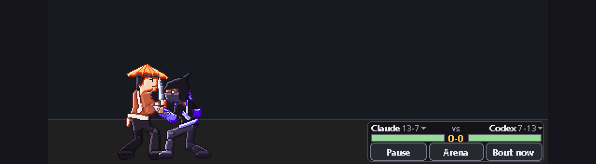

# README top-block patch

Replace everything in `README.md` above `## What it does` with the block between the two `---8<---` lines. Keep the
existing "Install with your AI agent" quote, which the block includes. Delete this file once merged.

Before merging, check that:

- `docs/demo.gif` exists (built by `python packaging/launch_media.py`),
- the v1.0.0 release has been published, because the Download buttons point at `releases/latest/download/...` and
  return 404 until then,
- the Windows exe actually starts (see `docs/LAUNCH.md`, section 0).

---8<---

<div align="center">


# Taskbar Fighters

**Your AI agents fight in your taskbar.**

Claude Code, Codex, Gemini, Cursor, Ollama, LM Studio and more, auto-detected and battling as pixel-art fighters based on what they're really doing.

[](https://github.com/mrktchris/taskbar-fighters/actions/workflows/ci.yml)
[](https://github.com/mrktchris/taskbar-fighters/releases/latest)
[](LICENSE)
[-0078d4)](#install-and-run)
[](https://www.python.org/downloads/)



</div>

- **Auto-detects your AI tools.** Every agent on your PC gets its own armed fighter (13 in all), with no hooks or
  config edits.
- **Fights from real usage.** They clash while an agent works, hand off when a task finishes, and get K.O.'d at the
  context limit. Best-of-3 matches, supers and ultimates.
- **Private by design.** It reads numbers only, never your prompts or files, and makes no network calls.

<div align="center">

[](https://github.com/mrktchris/taskbar-fighters/releases/latest/download/TaskbarFighters-windows.zip)
[](https://github.com/mrktchris/taskbar-fighters/releases/latest)
[](https://github.com/mrktchris/taskbar-fighters/releases/latest/download/TaskbarFighters-macos.zip)

**⭐ Star it if your agents deserve a fight.**

</div>

> **Install with your AI agent.** Paste this into Claude Code, Codex, Cursor or any coding agent:
>
> ```
> Install and run Taskbar Fighters from https://github.com/mrktchris/taskbar-fighters - follow AGENTS.md.
> ```
>
> The agent follows [AGENTS.md](AGENTS.md): it checks your PC, installs one Python package, runs the tests, starts the
> fighters and asks you before adding a startup entry or a Start-menu shortcut. Prefer to do it yourself? See
> [Install and run](#install-and-run).

<sub>The command-line tool is `minis.py`; "minis" is the internal short name you will see in commands, folders and the data
directory. The loop above is rendered offline by the app's own planner and renderer with DEMO numbers
(`python packaging/launch_media.py`).</sub>

---8<---

Notes for the merge:

- Until the package is on PyPI, the pip button links to the release page, which has the `.whl`. Once PyPI is live,
  point it at `https://pypi.org/project/taskbar-fighters/` and add `pip install taskbar-fighters` to "Install and run".
- Add a "Download" subsection to "Install and run": Windows zip (unzip, double-click `TaskbarFighters.exe`, SmartScreen
  > More info > Run anyway; `TaskbarFighters-cli.exe stop` to quit), and pip
  (`pip install <wheel>` then `taskbar-fighters start`).
- Add one line: "Run one copy at a time. A git checkout, a pip install and the zip share `%LOCALAPPDATA%\minis`."
