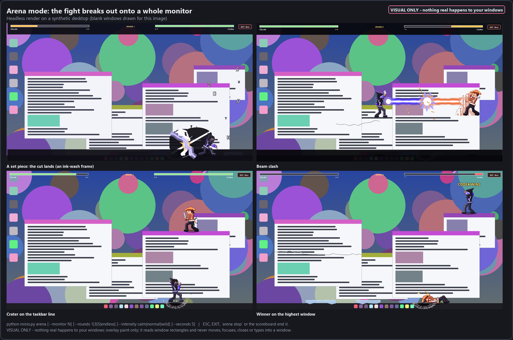
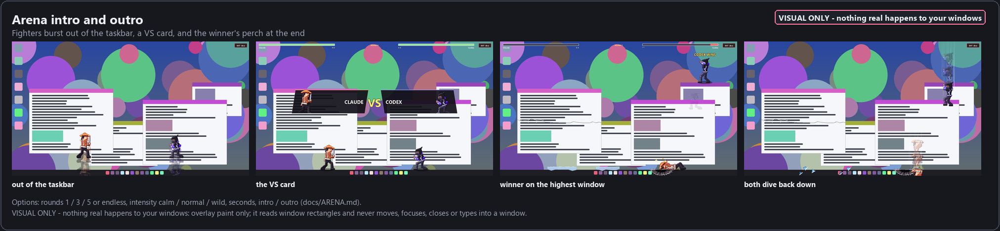
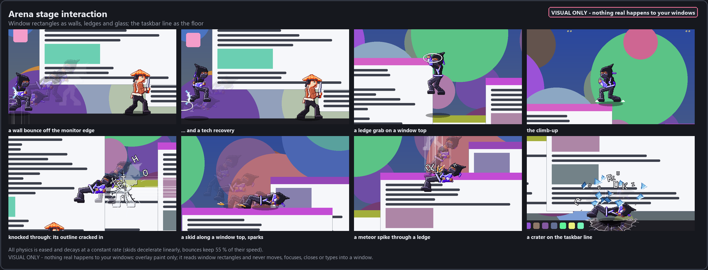
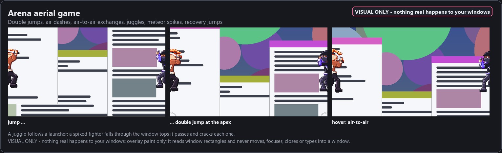
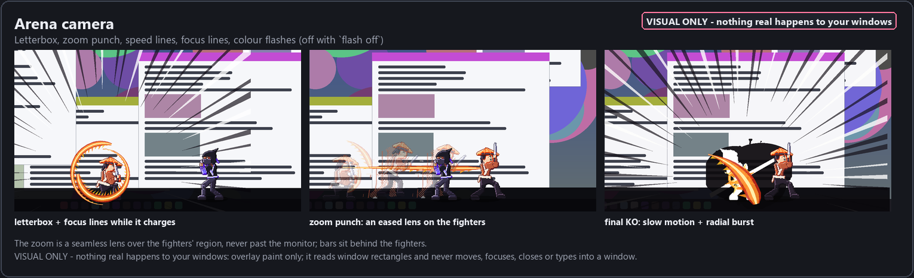
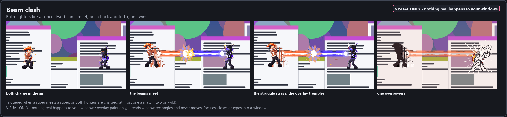
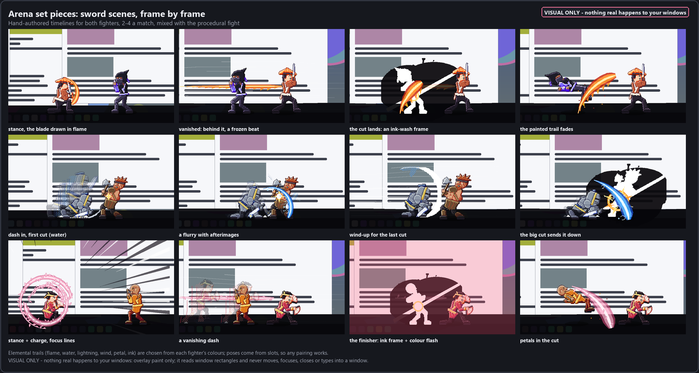
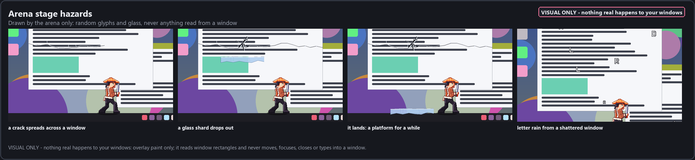

# Arena mode

Arena mode lets the two fighters leave the taskbar and fight across one whole monitor, in the style of a platform-fighter
game crossed with an anime battle. Window edges become walls and ledges, the taskbar line becomes the floor, and glass
cracks, shatters and rains letters.



**Visual only: nothing real happens to your windows.** The arena is one click-through overlay window, and everything you see
is paint on it. The program reads one thing from the desktop: the rectangles of visible windows, as numbers. It never reads
titles or contents. It never moves, resizes, focuses, closes, minimizes or types into any window. Screen shake moves the
overlay itself and nothing else. The optional freeze backdrop (`--freeze`) is a picture of the monitor that stays in memory
and is never written to disk. A test proves this: `VisualOnly7` in `tests/test_arena.py` runs the real arena process with a
recording shell and a recording `user32`. The test requires that the only shell call is the single-instance mutex and that
`user32` is never called.

## Starting and stopping

```
python minis.py arena [--monitor N] [--seconds S] [--freeze]
```

ESC, the EXIT button (top right), `python minis.py arena stop`, or the scoreboard's Arena button ends the arena. Pausing the
fighters (`minis.py pause`) pauses the arena too.

## Options

The arena takes six options. They are validated, and any bad value falls back to its default without an error.

| option | values | default | what it does |
| --- | --- | --- | --- |
| `rounds` | `1`, `3`, `5` (`0` or `"endless"` = endless) | `3` | best of 1, 3 or 5 |
| `endless` | `true` / `false` | `false` | free-for-all: rounds continue until stopped, no winner pose, nothing recorded |
| `intensity` | `calm`, `normal`, `wild` | `normal` | how much destruction and effects (table below) |
| `seconds` | number > 0 | none | the arena leaves on its own after this many seconds |
| `intro` | `true` / `false` | `true` | the VS card before round 1 |
| `outro` | `true` / `false` | `true` | the winner flies to the highest window to pose, then both dive back into the taskbar |

Where they come from, each layer overriding the one before:

1. the defaults above
2. `minis.json`, as `"arena": {"rounds": 5, "intensity": "wild"}`
3. `control.json` in the data folder, as `"arena_opts": {...}`. The scoreboard or menu can write this for one session.
4. `Arena(..., options={...})`, which is what the CLI flags map to

| intensity | `calm` | `normal` | `wild` |
| --- | --- | --- | --- |
| particles and letters | half | 1x | 1.8x |
| stage hazards | off | every ~8 s | every ~4 s |
| letter rain after a shatter | 1.2 s | 2.6 s | 4.5 s |
| zoom punch | 1.07x | 1.14x | 1.20x |
| letterbox | 70 % | 100 % | 120 % |
| colour flashes, speed lines | off | on | on |
| beam clashes per match | 1 (30 %) | 1 (55 %) | 2 (85 %) |
| meteor spike chance | 25 % | 50 % | 80 % |
| craters kept | 2 | 4 | 7 |
| knock-through speed | 1250 px/s | 950 px/s | 760 px/s |
| set-piece chance per exchange | 15 % | 25 % | 40 % |

## What happens in a match

### Intro and outro

The fighters burst out of the taskbar with a ring and land. Two name plates slide in from the sides, and "VS" drops in
between them. Then the round banner and FIGHT! appear. At the end, the winner flies to the highest window top and holds its
victory pose under a "<NAME> WINS" banner. The loser slumps up. Then both hop and dive back down into the taskbar.



### Stage interaction



- **Wall bounces.** A fighter knocked into a monitor edge, or into a window's side faster than 380 px/s, bounces back. It
  keeps 55 % of its speed, after a 60 ms stop and a spark. Slower hits just stop.
- **Tech recoveries.** On a bounce, the fighter sometimes flips off the wall onto its feet (35 to 55 % of bounces,
  depending on intensity).
- **Ledge grabs.** A fighter falling past a window's side catches the ledge, hangs with a small damped bob, and climbs up.
  The climb goes up first and then over the lip, eased at both ends. Defenders also fly to a ledge on purpose and catch it.
- **Knock-through.** A fighter knocked into glass fast enough goes through it. Its own silhouette is left cracked into that
  window: a frosted outline with radial cracks, clipped to the window. Slower hits crack or bounce. Three cracks shatter a
  window, as in V4.
- **Skids.** Landing a knock-back faster than 360 px/s slides at a constant 1500 px/s² deceleration. That gives about
  220 px from a knockdown. On a window top, sparks fly up and back. On the floor, dust rises. A fighter can skid off the end
  of a window top and fall, and sometimes catches the ledge.
- **Craters.** Landing on the taskbar line faster than 1500 px/s, or taking a ground-slam move there, leaves a crater:
  a dent with a lit rim and cracks running into the taskbar, plus rubble that bounces once. Craters stay for the match,
  up to the intensity's cap.

### Aerial game



- **Double jumps.** Air-to-air exchanges start with a jump and a second jump at its apex, with a ring under the feet. The
  second jump is sized to peak exactly at the meeting height, so the hover never snaps.
- **Air dashes.** In the air, an approach longer than 160 px is a dash, with afterimages and speed lines.
- **Juggles.** A launcher pops the defender up with light gravity, which gives hang time. The attacker jumps after it and
  strikes in the air.
- **Meteor spikes.** A knockdown in the air can spike the defender straight down. It falls through every window top it
  crosses, cracking each one with sparks, and lands in a crater with one bounce.
- **Recovery jumps.** A fighter knocked off into the air gets one jump back up, towards a nearby ledge if there is one.

### Camera



- **Letterbox.** Black bars ease in for supers, ultimates, clashes, set pieces and the final KO. The bars are drawn behind
  the fighters, so they never hide a foot on the taskbar line.
- **Zoom punch.** A seamless lens zooms the region around the fighters by up to 1.07x, 1.14x or 1.20x. The middle of the
  region is scaled while its rim stays fixed, so there is no seam. The zoom never reaches past the monitor. It is driven by
  a critically damped spring, so it eases in and out, and a second punch during a zoom continues the first instead of
  jumping.
- **Speed lines.** Speed lines appear behind dashes, air dashes, meteor falls and hard knock-backs.
- **Final KO.** The match-deciding blow freezes on contact, then plays the fall in slow motion behind animated radial
  focus lines, with a colour flash in the winner's accent. In endless mode, every KO gets this.
- **Flashes.** Colour flashes, white flashes, impact frames and ink frames all obey `minis.py flash off` (control.json
  `flashes`). With flashes off, there are no full-screen frames at all.

### Beam clash



When a super meets a super, or both fighters are charged (meter of at least 70 after the third exchange of a round), the
exchange can become an anime beam duel:

1. Both fighters fly to marks 720 px apart in the air and charge.
2. They fire. Two beams grow from their hands and meet in the middle.
3. The meeting point sways back and forth for about 2 s. The whole overlay trembles, sparks fly, and the fighters
   mash-shake.
4. In the last 40 %, the point drifts towards the loser. The winner overpowers: its beam races to the loser, and there is
   an explosion, impact frames, a zoom punch and a colour flash. The loser takes the winner's super or ultimate damage and
   is knocked down.

The winner follows the `winners` mode (`decided` biases it by the health score) blended with the current HP. A clash
spends both fighters' meters. There is at most one clash a match, or two on wild.

### Set pieces



Set pieces are hand-authored sword scenes: one timeline for both fighters, polished frame by frame, played 2 to 4 times a
match at dramatic moments and mixed with the procedural fight. A match always gets at least 2, and the last ones come
when a round may be the deciding one.

| set piece | what you see |
| --- | --- |
| `vanishing_cut` | A low stance as the blade is drawn in its element. The attacker vanishes, leaving a painted streak, and reappears behind the defender in its follow-through. Both hold still for a frozen beat. Then the cut lands: an ink-wash frame and a diagonal painted slash, and the defender falls. |
| `flurry` | A dash in, then five rapid cuts with afterimages, each a short painted arc across the body while the defender staggers back. A wind-up, then one big cut sends it down. |
| `stance_finisher` | A long stance and charge: three element swirls round the blade, focus lines and a slow zoom. A vanishing dash, a long frozen key pose with speed lines, then the finisher: a wide slash, an ink frame and a colour flash. |

**Elements.** Each fighter's trails are painted in one element, chosen from its colours: flame, water, lightning, wind,
petal or ink. An `element` key in the character's anim.json overrides the choice. Every element is an original design:

- flame: tongues licking off the arc
- water: curls breaking off it
- lightning: a forked zig-zag in the fighter's own tint
- wind: streaks riding the ribbon
- petal: petals shed along it
- ink: dry-brush gaps and splatter

A trail is a wide ribbon that follows the blade arc. It is painted on fast, held, then thinned from the tail and faded. The
big cuts pass through the defender's torso instead of circling it. Ribbons are drawn at the arena's full HD scale and
cached in 16 progress steps.

**Ink-wash impact frames.** When a set piece's cut lands, it shows an ink-wash frame for 180 ms: a black brush splash
behind the struck fighter, the struck fighter as a white silhouette, and a white cut across the splash. The attacker stays
drawn normally.

**Authoring format** (`minis_core/arena_setpieces.py`). A set piece is
`dict(gap, span, dur, dmg, keys=[(t, op, *args)])`. Times are real seconds from the set piece's start, and positions are
1-D along the line between the fighters: x = 0 is the attacker's mark, `gap` is the defender's, positive x is the way the
attacker faces. The ops are:

- `pose` (role, slot)
- `pos` (role, `x` or `near` = offset from the attacker's striking distance, `dur`, `ease`, `ghosts`)
- `alpha` (role, a)
- `ghost` (role)
- `face` (role, `toward` | `away`)
- `trail` (role, `cut(...)` or `dict(path='arc' | 'line', ...)`)
- `ink` (role)
- `hit` (`dmg`, `react` = `stagger` | `recoil` | `knockdown`, `push`, `final`)
- `spark`, `shake`, `flash`
- `cam` (`box`, `punch`, `lines`, `radial`)

**Pose slots** keep set pieces working for any pairing. Each slot reads a move from the fighter's own atlas, never by a
move's name:

| slot | pose |
| --- | --- |
| `stance` | low ready stance |
| `charge` | the power-up loop |
| `dash` | the dash smear frame |
| `wind`, `cut`, `follow` | the strongest blade strike's frame before contact, contact frame, and follow-through |
| `cut2`, `cut3` | the next strikes' contact frames |
| `guard` | block |
| `stagger`, `recoil` | hit / heavy hit |
| `idle` | release back to the normal animation |

The strikes are ranked from the atlas: grounded slashes first, then by power, with kicks, punches and aerial moves last.
A missing move falls back to idle and never raises.

To add a set piece, add an entry to `SETPIECES`, render it with the QA scripts described under Verification, and check
every frame at 1x and 2x before shipping it.

### Moves from the roster

The arena plays every move through the choreography API and reads what a move does from its traits. `move_traits()` reads
them from the beat's flags first, then the anim.json `traits` / `tags` / `family`, then the move's name:

| trait | what the defender does |
| --- | --- |
| `launcher` | popped up with juggle hang time |
| `throw` | hurled into walls and windows |
| `pull` | dragged back in |
| `boomerang` | the projectile flies back to its owner |
| `pound` | a crater, or a crack in the window top underfoot |

An attack kind the arena has never heard of still plays as an attack, and a move missing from an atlas is skipped.

### Stage hazards



- **Letter rain.** A shattered window rains random glyphs for a few seconds. The glyphs are random, never text read from
  anywhere.
- **Shard platforms.** Every few seconds (normal and wild only), a crack spreads across a window and a glass shard drops
  out of it. The shard lands on the first top below it and becomes a platform you can stand on for 12 s, then crumbles.

## Performance

These figures come from a headless benchmark: six seeded matches, 1920x1080, the premultiply conversion the real window
does on every write included, 30 fps. They are milliseconds per frame (tick + render + premultiply).

| | mean | p50 | p95 | max |
| --- | --- | --- | --- | --- |
| V6 (before) | 3.16 | 2.35 | 7.16 | 182 |
| V7 calm | 2.03 | 1.02 | 8.16 | 48 |
| V7 normal | 2.61 | 1.17 | 9.97 | 71 |
| V7 wild | 3.05 | 1.50 | 10.36 | 50 |

V7 costs less on average than V6, even though it draws more. Two changes pay for the new effects:

- The compositor now repaints only the drawables that appeared, moved, changed image or disappeared. An unchanged HUD,
  decal or banner is no longer repainted every frame.
- The letterbox repaints only the strip it grew or shrank by.

The expensive frames are the zoom lens (a 0.45-monitor region, nearest-neighbour mesh) and the few full-screen flash
frames. The process still drops to 20 fps when it goes over `arena_cpu_budget_pct`.

## Verification

- `tests/test_arena.py` holds the V4 to V7 arena tests, 50 in all. The V7 classes are:
  - `Options`: validation and layering, best of 1 and 5, endless with seconds, the VS card and the outro perch
  - `Stage7`: wall bounce, tech, ledge grab and smooth climb, knock-through crack, linear skid, meteor and crater cap,
    double-jump hover, recovery, shard platform, letter rain
  - `Camera7`: the lens never leaves the monitor and eases with no jumps, a second punch continues the first, the
    letterbox eases and is drawn behind the fighters, colour flashes and ink frames obey `flashes`
  - `Intensity7`: effect counts scale with the intensity
  - `Clash7`: event order, the winner's damage, the sway, the per-match cap
  - `SetPieces7`: 2 to 4 per match, every set piece for two pairings, slot fallbacks, every element
  - `Moves7`: traits, and an unknown attack kind still plays
  - `VisualOnly7`: no window API is ever called
- Previews are rendered headless onto a RAM surface over a synthetic busy desktop, never a screen grab. The doc images are
  made by `tools/doc_images.py` (`arena_overview()`, `arena_v7_imgs()`).
